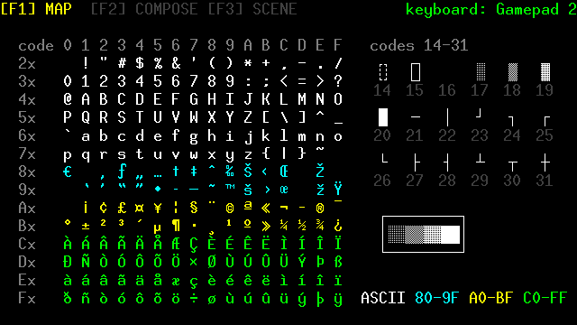
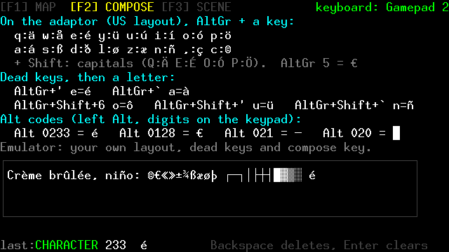
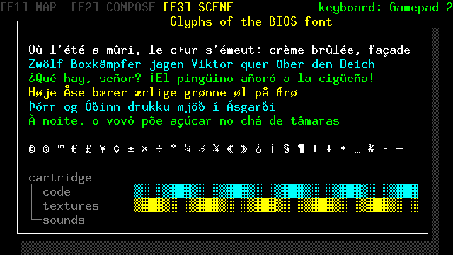

# v32io examples

Five small programs using [`v32/keyboard.hpp`](../../../v32/keyboard.hpp)
and [`v32/mouse.hpp`](../../../v32/mouse.hpp) (both built on
[`v32/v32io.hpp`](../../../v32/v32io.hpp)), the
v32c++ keyboard and mouse support. Full documentation:
[`docs/V32IO.md`](../../../docs/V32IO.md).

> **These need a v32io device.** A v32io keyboard or mouse reaches the
> console through a gamepad port, and something outside the console has
> to produce its data: **either** the v32io hardware adaptor (a USB
> keyboard or mouse plugged into the v32io-pico board, which works with
> any Vircon32 emulator), **or** a modified Vircon32 DesktopEmulator with
> the `v32kbd` / `v32mouse` gamepad devices — the fork at
> <https://github.com/wedge1020/ComputerSoftware/tree/v32io> (its `v32io`
> branch), or the stock emulator patched with the v32io repository's
> `emulator/*.patch`. The stock emulator's own *Keyboard* device is **not**
> a v32io keyboard. Without a device, the programs run but report the
> missing device and do nothing else useful (except `monitor`, which then
> just shows your gamepads).

| Program          | Devices                                   | What it shows                                                                 |
| ---------------- | ----------------------------------------- | ----------------------------------------------------------------------------- |
| `typewriter.cpp` | keyboard on **Gamepad 2**                 | `v32::Keyboard::read()`, shift / caps lock, modifier state                    |
| `paint.cpp`      | mouse on **Gamepad 2**                    | `v32::Mouse`: pointer, bounds, button edges, movement                          |
| `monitor.cpp`    | anything, on all four ports               | `v32::IoDevice`: the raw 11 controls, decoded both ways — a setup/debug tool   |
| `notepad.cpp`    | keyboard on **Gamepad 2**, mouse on **Gamepad 3** | two v32io devices at once                                             |
| `glyphs.cpp`     | keyboard on **Gamepad 2** (optional: two of three pages need no device) | every BIOS font glyph (accents, box drawing, shades), typing them, `Keyboard::glyph()`, typed characters vs. keys |

Gamepad 1 is left for an ordinary gamepad in every example. Each program
names its port(s) in a `#define` near the top (`KEYBOARD_PORT`,
`MOUSE_PORT`) if your setup differs.

## glyphs: the font, and typing it



The Vircon32 BIOS font draws more than ASCII: Windows-1252 letters and
symbols, and box drawing characters and shades where the control codes
would be. `glyphs` has three pages (F1 / F2 / F3, Tab, or gamepad 1's
Left / Right; they also turn by themselves):

| Page | Shows |
| ---- | ----- |
| **MAP** | every glyph, in a table by code (colored by range), with the box drawing set (codes 14–31) beside it |
| **COMPOSE** | how to type them (AltGr combinations, dead keys, Alt codes on the adaptor; the computer's own layout on the emulator), a box to try it in, and whether the last thing typed arrived as a **KEY** or as a typed **CHARACTER** |
| **SCENE** | a window of box drawing characters with a drop shadow, pangrams in six languages, symbols and animated shades |




MAP and SCENE need no device. For COMPOSE, use the keyboard on Gamepad 2.
Without one, `glyphs.actions` plays a typing session the way the adaptor
sends it, and `v32shot` photographs the result (that is how the pictures
above were made; see "Testing without a device" below).

How the demo reads a typed character (one of three styles; see
docs/V32IO.md): `typewriter` and `notepad` use `read()` + `glyph()`;
`glyphs` uses `next_event()` and `event.text`. Text with box drawing
glyphs is built from `int` codes, because the Vircon32 toolchain can't
carry codes 14–31 in a string literal.

## Building

```sh
make            # bin/typewriter.v32, bin/paint.v32, bin/monitor.v32, bin/notepad.v32, bin/glyphs.v32
make debug      # the same, with -g debug maps
make clean
```

Needs `v32c++` and the Vircon32 DevTools (`compile`, `assemble`,
`packrom`) on the `PATH`. The Makefile passes `-I ../../..`, so the
repository's own `v32/` headers are used without `make sysinstall`. The
top-level `demos/Makefile` builds this directory along with the others.

## Running

**Modified DesktopEmulator:** load the cartridge, then in the *Gamepads*
menu pick *Gamepad 2* and select `v32kbd` (typewriter) or `v32mouse`
(paint); for notepad, `v32kbd` on Gamepad 2 and `v32mouse` on Gamepad 3.
`v32kbd` can't be selected while any gamepad uses the *Keyboard* device
(both need the host keyboard). With `v32mouse`, focusing the window
captures the pointer: **left Ctrl + left Alt** releases it.

**Hardware adaptor:** plug the adaptor (keyboard or mouse in it) into the
computer, and give the `v32io:kbd` / `v32io:mouse` joystick a profile that
maps **button *n* to control *n*** (see docs/V32IO.md, "Joystick profile").
Then assign that joystick to the gamepad the program expects. If something
looks wrong, run `monitor` first: it shows exactly what each port sends.

## Testing without a device

`tools/vircon32/v32io-script.py` turns keyboard and mouse actions into an
input script for the headless tools, which is how these examples were
checked:

```sh
cat > typing.act <<'EOF'
connect 1 1
at 300
kbd 1 type Hello, Vircon32!
EOF
tools/vircon32/v32io-script.py typing.act > typing.txt
tools/vircon32/bin/v32shot tools/vircon32/bin/StandardBios.v32 \
    demos/cxx/v32io/bin/typewriter.v32 typing.txt shot 360
```

(`at 300`: the standard BIOS hands over to the cartridge around frame 250.)

Typed characters (what the adaptor or the emulator send for é, ß, ┌ ...)
are scripted with `kbd 1 char 233 0x80 20`: BIOS font codes, two frames
each. `glyphs.actions` is a complete example:

```sh
tools/vircon32/v32io-script.py demos/cxx/v32io/glyphs.actions > glyphs.input
tools/vircon32/bin/v32shot tools/vircon32/bin/StandardBios.v32 \
    demos/cxx/v32io/bin/glyphs.v32 glyphs.input shot 340 520 570
```
